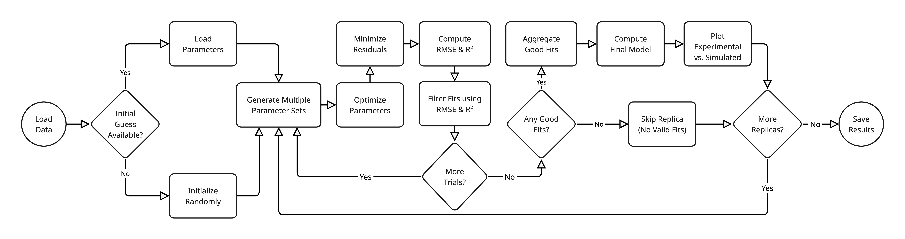

# Scientific Summary of the Molecular Binding Assay Fitting Toolkit

## 1. Introduction

This report provides a high-level overview of the scientific principles, mathematical frameworks, and algorithmic strategies employed by the Molecular Binding Assay Fitting Toolkit. The software is designed to analyze spectroscopic data from various molecular binding assays—specifically Guest Displacement Assays (GDA), Indicator Displacement Assays (IDA), and Direct Binding Assays (DBA). Its primary objective is to accurately quantify binding affinities (equilibrium constants) and physical response parameters (e.g., fluorescence coefficients) by fitting theoretical models directly to experimental observations.

## 2. Scientific Methodology: The Forward Modeling Approach

The core philosophy of this codebase is **Forward Modeling**. Traditional methods in supramolecular chemistry often rely on linearizing data (e.g., Scatchard or double-reciprocal plots) to extract binding constants. While computationally simple, these transformations distort the experimental error structure, leading to biased estimates and unreliable confidence intervals.

In contrast, this toolkit employs a direct non-linear regression approach:
1. **Model Prediction:** Based on a set of trial parameters (e.g., binding constants), the software simulates the exact concentrations of all chemical species at equilibrium.
2. **Signal Simulation:** It then calculates the expected physical signal (e.g., fluorescence intensity) corresponding to these concentrations.
3. **Optimization:** The algorithm iteratively adjusts the parameters to minimize the discrepancy between the simulated signal and the raw experimental data.

This approach preserves the native error distribution of the measurement, allows for the application of rigorous physical constraints (e.g., ensuring concentrations are non-negative), and enables the analysis of complex competitive systems that do not lend themselves to simple linearization.

## 3. Mathematical Framework

The mathematical engine of the toolkit is built upon the fundamental laws of chemical thermodynamics and mass conservation.

### 3.1. Law of Mass Action

The interactions are modeled as reversible equilibrium processes. For a simple 1:1 binding event between a Host ($H$) and a Guest ($G$), the equilibrium is governed by the association constant ($K_a$) or dissociation constant ($K_d$):
$$ H + G \rightleftharpoons HG $$
$$ K_a = \frac{[HG]}{[H][G]} $$

### 3.2. Mass Balance Equations

To solve for the unknown free concentrations ($[H]$, $[G]$) required by the mass action law, the software utilizes mass balance equations. These equations state that the total concentration of a species (a known experimental input) is the sum of its free form and its bound forms.

- **Direct Binding:** Leads to a system of equations that can be reduced to a **quadratic equation**, allowing for an analytical solution for the complex concentration.
- **Competitive Binding (GDA/IDA):** Involves two competing equilibria (Host-Dye and Host-Guest). This results in a more complex system that reduces to a **cubic equation** with respect to the free host concentration. Unlike the quadratic case, this often requires numerical solution methods to ensure stability and physical validity.

### 3.3. Signal Response Model

The observable signal ($I$) is modeled as a linear combination of the contributions from all active species. For a fluorescence assay, this follows the additive property of intensity:
$$ I = I_0 + \sum I_i [C_i] $$
Where $I_0$ is the background signal, $[C_i]$ is the concentration of species $i$, and $I_i$ is its molar response factor (e.g., brightness).

**Connecting Parameters to Measurement Data:**
The signal equation provides the critical link between the chemical model and the experimental data. The concentrations $[C_i]$ are determined by the binding constants ($K_a$) via the mass balance equations. Thus, the calculated signal depends directly on the unknown parameters ($K_a, I_i$). The fitting process simply adjusts these parameters until the calculated signal matches the measured data.

The process works as a chain of dependencies:
1. **Input Parameters:** The algorithm starts with a guess for the unknown parameters: the binding constant ($K_a$) and the molar response factors ($I_i$).
2. **Chemical Equilibrium:** Using the $K_a$ and the known total concentrations of reagents, the mass balance equations are solved to determine the exact equilibrium concentration $[C_i]$ of every species in the solution.
3. **Signal Prediction:** These calculated concentrations are plugged into the signal equation above to predict what the instrument should read ($I_{calc}$).
4. **Comparison:** This predicted signal is compared to the actual measured data ($I_{obs}$). The difference (residual) guides the optimization algorithm to refine the parameters for the next cycle.
5. **Iteration:** Steps 1-4 are repeated until convergence is achieved, meaning the predicted signal closely matches the observed data within a defined tolerance. The resulted parameters ($K_a, I_i$) are then considered the best estimates.

## 4. Algorithmic Implementation

The toolkit integrates several classes of algorithms to solve the inverse problem of finding parameters that best explain the measurement data.

### 4.1. Numerical Optimization

The central engine uses **Bound-Constrained Quasi-Newton Methods** (specifically L-BFGS-B).
- **Role:** To navigate the multi-dimensional parameter space and find the set of values that minimizes the sum of squared residuals (the difference between measurement data and mathematical model).
- **Why this algorithm:** It efficiently handles "box constraints," allowing the software to enforce physical limits (e.g., binding constants must be positive) without computationally expensive penalty functions.

### 4.2. Root-Finding Algorithms

For competitive assays (GDA/IDA), the free host concentration cannot be isolated algebraically in a robust manner.
- **Role:** The software employs **Brent’s Method** (a robust root-finding algorithm combining bisection, secant, and inverse quadratic interpolation) to numerically solve the mass balance equation for every single data point during the fitting process.
- **Why this algorithm:** It guarantees convergence to a root within a bracketed interval, ensuring that the calculated concentrations are always physically meaningful (i.e., between zero and the total concentration).

### 4.3. The Multi-Start Ensemble and What It Measures

The optimizer is launched many times (default 100) from different random starting points, **always on the same measured data**. Every attempt that clears the R² floor — and the optional RMSE trim — enters the accepted pool.

- **What the pool is for:** it maps how reproducibly the optimizer converges on this data set. A tight pool means the search lands on the same solution from wherever it starts; a split pool means the residual surface has more than one basin and the reported value depends on which one was found.
- **What is reported:** the estimate is the **representative fit** — an actual member of the accepted pool, so it lies on the model's degenerate manifold and reproduces the plotted curve exactly. Beside it the app quotes the range (minimum, maximum) that the accepted pool spans; the summary table adds the median ± MAD, the mean ± SD and the central-68 % interval of the same pool. Median-based figures are robust to an attempt that converged poorly, which is why they appear next to the mean-based ones.
- **What the pool is not:** it is not the experimental uncertainty of $K_a$. It carries no information the single data set does not already contain, because no attempt resamples or perturbs the measurements. The two questions it cannot answer are answered separately: how precisely the data determine $K_a$ (Section 6) and how much the entered conditions determine it (Section 7).

### 4.4. Physical Constraints: Non-Negative Signal Intensities

All parameters representing physical signal intensities or association constants are **strictly non-negative**:

- $K_a > 0$ — association constants are ratios of concentrations at equilibrium.
- $I_0 \geq 0$ — baseline/background signal from the instrument.
- $I_{\text{dye,free}} \geq 0$ — molar response of free dye.
- $I_{\text{dye,bound}} \geq 0$ — molar response of bound dye (host-dye complex).

The optimizer enforces this via lower-bound constraints ($\geq 0$) on all signal parameters across all assay types. Functions that derive parameter bounds from prior fits (e.g. propagating dye-alone calibration results to downstream DBA/GDA/IDA fits) also clamp lower bounds to zero. Raw measured signals may occasionally appear negative due to instrument noise or baseline drift, but the underlying physical quantities being modelled are always non-negative.

## 5. Parameter Identifiability and Signal Coefficient Degeneracy

### 5.1. The Problem

The 4-parameter signal model $I = I_0 + I_{\text{dye,free}} [D_{\text{free}}] + I_{\text{dye,bound}} [HD]$ contains a **structural degeneracy** in certain assay configurations. Different combinations of $(I_0, I_{\text{dye,free}}, I_{\text{dye,bound}})$ can produce **identical predicted signals**, making these parameters individually non-identifiable from curve fitting alone.

### 5.2. Mathematical Origin

The degeneracy arises from the **mass conservation constraint** on the fixed species.

**IDA example** (fixed dye, $d_0$ constant):

From dye mass balance: $[D_{\text{free}}] = d_0 - [HD]$. Substituting into the signal equation:

$$I = I_0 + I_{\text{dye,free}}(d_0 - [HD]) + I_{\text{dye,bound}}[HD]$$

$$I = \underbrace{(I_0 + I_{\text{dye,free}} \cdot d_0)}_{\text{effective offset}} + \underbrace{(I_{\text{dye,bound}} - I_{\text{dye,free}})}_{\text{effective contrast}} \cdot [HD]$$

The three parameters $(I_0, I_{\text{dye,free}}, I_{\text{dye,bound}})$ collapse into **two effective degrees of freedom**: an offset and a contrast. Any parameter triplet satisfying the same offset and contrast produces an identical signal curve. This defines a **one-dimensional degenerate manifold** in parameter space.

**DBA example** (DtoH mode, fixed host $h_0$):

Similarly, host mass balance gives $[H_{\text{free}}] = h_0 - [HD]$. If the signal model uses $[H_{\text{free}}]$ as one of the species (as in the current quadratic solver), the same reduction applies:

$$I = (I_0 + I_{\text{dye,free}} \cdot h_0) + (I_{\text{dye,bound}} - I_{\text{dye,free}}) \cdot [HD]$$

Again, three parameters map to two effective quantities.

**GDA** has a weaker form of this degeneracy because both $[D_{\text{free}}]$ and $[HD]$ vary independently (dye is the titrant, so $d_0$ is not constant). However, in practice, the sensitivity surface for $K_{a,\text{guest}}$ is relatively flat when signal coefficient bounds are wide, making GDA fits less stable than DBA or IDA for $K_a$ recovery.

### 5.3. Consequences

| What is identifiable | What is NOT identifiable |
|---------------------|------------------------|
| $K_a$ (controls curve **shape** via equilibrium) | Individual $I_0$, $I_{\text{dye,free}}$, $I_{\text{dye,bound}}$ |
| Effective offset $(I_0 + I_{\text{dye,free}} \cdot c_{\text{fixed}})$ | Their individual contributions |
| Effective contrast $(I_{\text{dye,bound}} - I_{\text{dye,free}})$ | Decomposition into the two coefficients |
| Overall fit quality ($R^2$, RMSE) | Which parameter triplet is "correct" |

Practically this means:
- The optimizer can find a **perfect fit** ($R^2 \approx 1$) with the **wrong** signal coefficients.
- $K_a$ is reliably recovered regardless — it is the only parameter that affects the curve's inflection point and saturation behavior.
- Fitting with wide signal coefficient bounds typically produces artificially large or small values for $I_{\text{dye,free}}$ compensated by $I_0$.

### 5.4. Recommended Inspection Steps

To systematically demonstrate and inspect this degeneracy:

1. **Generate synthetic data** from known ground-truth parameters using the forward model.
2. **Fit with wide signal coefficient bounds** (e.g., $10^4$ to $10^{12}$ for both $I_{\text{dye,free}}$ and $I_{\text{dye,bound}}$).
3. **Compare fitted vs. true values**:
   - $K_a$ should be recovered within tolerance (≤10% for clean data).
   - $I_{\text{dye,free}}$ and $I_{\text{dye,bound}}$ will deviate significantly from truth (often $>50\%$  error), yet $R^2 \approx 1$.
4. **Verify degeneracy invariant**: Compute the effective offset and contrast from the fitted parameters — they should match the true values even when individual coefficients do not.
5. **Repeat with tight signal coefficient bounds** (±20% of truth): $K_a$ recovery improves because the degenerate manifold is constrained.
6. **Sweep $I_0$**: Fix $I_{\text{dye,free}}$ and $I_{\text{dye,bound}}$ at their true values, vary $I_0$, and recompute the signal — observe that offsetting $I_0$ by $\Delta$ and $I_{\text{dye,free}}$ by $-\Delta / c_{\text{fixed}}$ produces an identical curve.

### 5.5. Mitigation Strategies

- **Fix signal coefficients from a prior DBA calibration.** In the standard experimental workflow, DBA is performed first, and the resulting $I_{\text{dye,free}}$ and $I_{\text{dye,bound}}$ are treated as known constants in subsequent GDA/IDA fits. This eliminates the degeneracy entirely and is the scientifically correct approach.
- **Use tight bounds** (±20%) on signal coefficients when fitting, if fixing them is not feasible.
- **Set $I_0 = 0$** in synthetic test scenarios to reduce the parameter-space dimension and simplify optimizer convergence diagnostics.
- **Report the effective offset and contrast** rather than (or in addition to) the individual coefficients, since these are the physically identifiable quantities.

## 6. Confidence Interval for $K_a$: The Exact Profile

### 6.1. Separating the Linear Parameters

Every assay with a single association constant (GDA, IDA, both DBA modes) has a signal that is *linear* in all of its remaining parameters:

$$I(K_a, \boldsymbol{\beta}) = X(K_a)\,\boldsymbol{\beta}, \qquad \boldsymbol{\beta} = (I_0, I_{\text{dye,free}}, I_{\text{dye,bound}})^{\mathsf{T}}$$

The design matrix $X(K_a)$ holds one column per coefficient, obtained by evaluating the forward model with that coefficient set to one and the others to zero — so the equilibrium solve, and only it, depends on $K_a$.

With $K_a$ held fixed, the best $\boldsymbol{\beta}$ is therefore a **bounded linear least-squares** solve, not a search. This is the variable-projection idea of Golub and Pereyra (1973, 2003): the nonlinear parameter is profiled and the linear ones are projected out. Sweeping $K_a$ over its bounds gives

$$\mathrm{SSR}(K_a) = \min_{\mathbf{lb} \le \boldsymbol{\beta} \le \mathbf{ub}} \lVert \mathbf{y} - X(K_a)\boldsymbol{\beta} \rVert^2$$

exactly at every point, with three consequences: the curve upper-bounds the $R^2$ of every fit the multi-start optimizer can find, its peak is located by a grid search along the curve with a bounded refinement, not by a multi-start search, and its shape is the profile likelihood of $K_a$ under Gaussian errors.

Columns are norm-scaled before the solve, which keeps coefficients spanning many orders of magnitude well conditioned, and a coefficient pinned by equal bounds leaves the solve and contributes a fixed signal.

### 6.2. The F-Test Interval

The interval keeps every $K_a$ whose residual sum of squares is not significantly above the minimum (Bates & Watts 1988; Seber & Wild 1989; Venzon & Moolgavkar 1988):

$$\mathrm{SSR}(K_a) \;\le\; \mathrm{SSR}_{\min}\left(1 + \frac{F(\alpha;\, 1,\, n - p)}{n - p}\right)$$

- $n$ — points in the profiled signal.
- $p = 1 + \operatorname{rank} X(K_{a,\text{best}})$ — one for $K_a$ plus the **numerical rank** of the free coefficient columns, unless equal bounds pin $K_a$, in which case $K_a$ is not fitted and $p$ is the rank alone. Counting the nominal number of coefficients would be wrong here: the signal coefficients are structurally degenerate (Section 5), so two columns the data cannot separate must contribute one degree of freedom, not two. The rank is taken from the singular values of the norm-scaled design, whose exact dependencies sit near $10^{-11}$ because the equilibrium solve is iterative, while independent columns stay above $10^{-6}$.

The edges are located by root-finding on the exact curve. An edge that reaches a $K_a$ bound without crossing the threshold is reported as **open**: the measurement places no limit on $K_a$ on that side, and the result is a limit rather than an interval. This is the practical-identifiability reading of a profile likelihood in the sense of Raue et al. (2009).

### 6.3. Replicates Are Averaged, Not Pooled

The profile, the best fit and the interval describe the **average of the active replicates**. Replicates of one titration share their systematic departure from the model: if the model misses a point, it misses that point in every replicate. Treating $m$ replicates as $m \times n$ independent observations counts one shared miss $m$ times as independent evidence: the interval narrows — by up to about $\sqrt{m}$ where that miss dominates the scatter — while the miss itself, the dominant error, stays exactly where it was.

`scripts/profile_interval_coverage.py` measures the interval on synthetic IDA data, 200 designs per scenario, nominal 95 %:

| Scenario | Coverage of the true $K_a$ |
|---|---|
| Independent noise of constant size | 0.96 |
| Noise proportional to the signal | 0.91 |
| Four replicates sharing a smooth 2 % misfit | 0.77 |
| The same, with the replicates' points pooled as independent | 0.67 |

Constant-variance scatter is the assumption the F test is built on, and it is met. Proportional noise breaks it mildly and costs a few points of coverage. A shared systematic misfit breaks it badly — and the last row is why the app averages: pooling would make the same data look more informative while being less accurate.

## 7. Input Sensitivity: Sobol' Variance Decomposition

The interval of Section 6 conditions on the entered experimental conditions being correct. The sensitivity analysis removes that condition: each input is given a stated uncertainty, and the fit is repeated over the resulting input distribution.

### 7.1. Inputs and Their Distributions

The perturbable inputs are the fixed conditions ($h_0$, $d_0$, $K_{a,\text{dye}}$, …) and the titrant concentration vector. Each is drawn independently, through its inverse CDF, so the same definition of an input's distribution serves plain random draws and a low-discrepancy sequence alike:

- a $\sigma$ spec (in percent of nominal, or in the input's own unit) draws from a normal distribution truncated at zero, so a concentration never goes negative;
- an interval spec draws uniformly between its ends, the form in which a $K_a$ carried over from an earlier fit naturally arrives.

The titrant enters as **one common factor**: a single draw scales the whole concentration vector, which is how a mis-calibrated stock solution acts — it displaces every titration point together, not each one independently.

### 7.2. Estimators

For output $Y = \log_{10} K_a$ and inputs $X_1 \dots X_k$, the first-order and total-order Sobol' indices (Sobol' 2001) are

$$S_i = \frac{\operatorname{Var}_{X_i}\!\big(E[Y \mid X_i]\big)}{\operatorname{Var}(Y)}, \qquad S_{T_i} = \frac{E\!\big[\operatorname{Var}(Y \mid X_{\sim i})\big]}{\operatorname{Var}(Y)}$$

They are estimated on a Saltelli design: two independent sample matrices $A$ and $B$ and the $k$ matrices $AB_i$ that take column $i$ from $B$ — $N \times (k + 2)$ fits in total. First order uses the Saltelli et al. (2010) estimator and total order the Jansen (1999) estimator:

$$\hat{S}_i = \frac{\frac{1}{N}\sum_j f(B)_j\big(f(AB_i)_j - f(A)_j\big)}{\hat{V}}, \qquad \hat{S}_{T_i} = \frac{\frac{1}{2N}\sum_j \big(f(A)_j - f(AB_i)_j\big)^2}{\hat{V}}$$

The outputs are centred on the mean of $A$ and $B$ before either estimator is applied. Neither expectation changes under a constant shift, but the variance of the first-order estimator grows with the square of the output mean, and $\log_{10} K_a$ sits near 8 with a spread of a few tenths — uncentred, the first-order indices would be buried in that offset.

$\log_{10} K_a$ rather than $K_a$ is decomposed because an association constant varies multiplicatively over orders of magnitude; a variance decomposition of $K_a$ itself would be dominated by whichever input happens to push it highest.

### 7.3. Sampling Error of an Index

The design is built from $B = 8$ **independently scrambled** Sobol' blocks (Owen 1997; L'Ecuyer & Lemieux 2002), each the first $N/B$ points of its own scrambled sequence. The indices come from all usable rows pooled; leaving each block out in turn gives a delete-one-block jackknife standard error (Archer, Saltelli & Sobol' 1997),

$$\mathrm{SE} = \sqrt{\frac{B-1}{B}\sum_j \big(\hat{\theta}_{(j)} - \bar{\hat{\theta}}\big)^2}, \qquad \text{CI} = \hat{\theta} \pm t_{B-1,\,0.975}\,\mathrm{SE}$$

The blocks are independent replicates of one design; the rows *inside* a scrambled block are not independent draws and cannot stand in for them. The interval covers the Monte Carlo sampling error of one index at a time — not error in the stated input uncertainties, and not model error. It is symmetric and is not clipped to $[0, 1]$, so a small index can show a negative lower end.

`scripts/sobol_interval_coverage.py` reproduces the calibration, and `scripts/README.md` carries the table it prints. Over 1000 designs each of the Ishigami function and of a six-input g-function at $N = 1024$, the nominal 95 % intervals covered the analytically known index in 94.2–97.1 % of designs, and the estimator's bias stayed within 0.07 standard deviations. The same script measures the price of blocking: at a fixed budget, eight blocks raise the root-mean-square error of an index by up to a factor of about five, index by index — a few indices are barely affected — over a single undivided scramble, which is the cost of having an error bar at all.

### 7.4. Fits Below the $R^2$ Floor Are Kept

Each sample is fitted through the exact profile of Section 6, so its $K_a$ is the best point of that profile for its perturbed inputs, located by a grid search along it with a bounded refinement. The fit is kept whatever its $R^2$; the ones below the floor are flagged and drawn in grey. Dropping them would remove precisely the input combinations the data disagree with, which would bias the sampled distribution back towards the inputs as entered and make the analysis look more reassuring than the evidence allows.

The analysis therefore covers the assays with a single association constant. For a model with two binding constants the projection of Section 6.1 does not apply, and the tab reports the analysis as unavailable rather than substituting a search whose spread would mix input error with optimizer scatter.

## 8. General Theoretical Workflow Diagram

